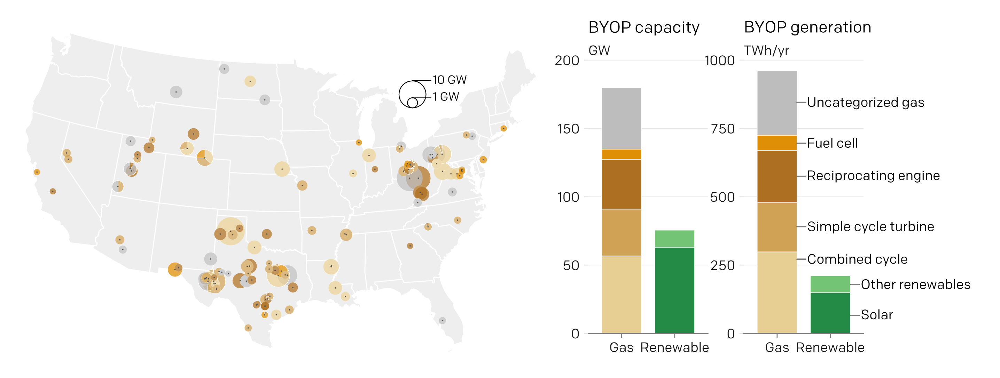

# Analyzing the impacts of BYOP
This repository is still under construction, but we will update this soon with the code behind our report analyzing Bring Your Own Power (BYOP) projects for data centers.

The full dataset can be found [here](https://docs.google.com/spreadsheets/d/1Pl4FgCxeDJ2Dc4P8TlF33bf7IdqPpyikRd4-VX64jrQ/edit?gid=1580942818#gid=1580942818).

Read the full report at https://earthjustice.org/byop.

[*The AI Gas Rush: Risks and Implications of "Bring Your Own Power"*](https://earthjustice.org/byop). Better Data Center Project and Earthjustice. October 2026.

## License

The data of this project is licensed under the [Creative Commons Attribution 4.0 license (CC-BY-4.0)](https://creativecommons.org/licenses/by/4.0/), and the accompanying analysis and visualization code is licensed under the [MIT license](LICENSE.md).
